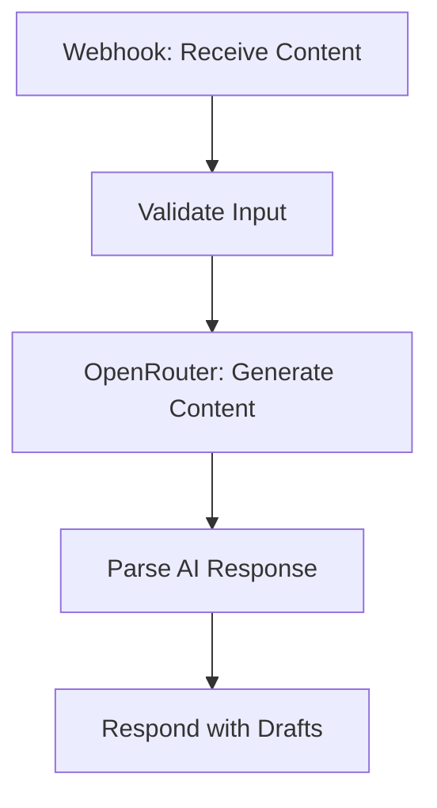

# AI Content Repurposing Factory


An AI-powered n8n automation workflow that transforms a single piece of source content into platform-specific drafts for LinkedIn, Instagram, X, blogs, and newsletters using OpenRouter.

## Overview

The **AI Content Repurposing Factory** automates the process of adapting existing content for multiple publishing platforms. Instead of manually rewriting the same content for different audiences, users can submit source text and specify their preferred platforms, tone, target audience, and language.

The workflow validates the input, sends it to an AI model through OpenRouter, processes the generated response, and returns structured JSON containing the resulting drafts.

## Features

- **Multi-platform content generation** — supports LinkedIn, Instagram, X, blogs, and newsletters.
- **AI-powered rewriting** — adapts source material to the requested tone and audience.
- **Input validation** — checks source text length, selected platforms, tone, and language.
- **Webhook integration** — accepts content through an HTTP POST request.
- **Structured JSON output** — returns generated drafts in a format suitable for frontend applications and downstream automations.
- **Error handling** — detects missing AI responses, malformed JSON, and empty draft results.
- **Credential-based authentication** — supports Header Auth for incoming webhook requests and OpenRouter API requests.

## Workflow Architecture



### Workflow Nodes

| Node | Responsibility |
|---|---|
| 01 - Webhook - Receive Content | Receives incoming content and preferences |
| 02 - Validate Input | Validates source text, platforms, tone, audience, and language |
| 03 - Generate Content | Sends the validated input to OpenRouter |
| 04 - Parse AI Response | Extracts and validates the generated JSON |
| 05 - Respond with Drafts | Returns the generated drafts to the caller |

## Tech Stack

- **Workflow Automation:** n8n
- **AI Integration:** OpenRouter API
- **Language:** JavaScript
- **Communication:** REST API, HTTP POST, Webhooks
- **Data Format:** JSON
- **Authentication:** HTTP Header Authentication

## Supported Platforms

| Platform | Purpose |
|---|---|
| LinkedIn | Professional posts and industry insights |
| Instagram | Social media captions |
| X | Short-form posts |
| Blog | Long-form content drafts |
| Newsletter | Email newsletter content |

## Getting Started

### Prerequisites

Before running the workflow, make sure you have:

- A running n8n instance.
- An OpenRouter account and API key.
- Access to an OpenRouter model that supports the configured request.
- An HTTP client such as Postman, Insomnia, or `curl` for testing.

### 1. Clone the Repository

```bash
git clone https://github.com/belioautomation/ai-content-repurposing-factory.git
cd ai-content-repurposing-factory
```

### 2. Import the Workflow

1. Open your n8n instance.
2. Navigate to **Workflows**.
3. Select **Import from File**.
4. Choose `AI-Content-Repurposing-Factory.json`.
5. Open the imported workflow.

### 3. Configure Authentication

**Incoming Webhook**

Create an n8n Header Auth credential and assign it to the `01 - Webhook - Receive Content` node. Use a private header name and value of your choice.

**OpenRouter API**

Create another Header Auth credential for the `03 - Generate Content` node:

- Header Name: `Authorization`
- Header Value: `Bearer YOUR_OPENROUTER_API_KEY`

Replace the placeholder with your actual API key. Store credentials in n8n, not in this repository.

Verify the configured model ID in the HTTP Request node. If it is unavailable, replace it with a model supported by your OpenRouter account that can follow the required JSON output format.

### 4. Activate and Test

Save the workflow and use its test webhook URL while testing. Activate the workflow when you're ready to use its production webhook URL.

The endpoint path is:

```text
POST /webhook/content-repurpose
```

The full URL depends on your n8n host and webhook mode.

## API Usage

Send a JSON request containing the source text and your preferred generation settings.

### Example Request

```json
{
  "sourceText": "Artificial intelligence is transforming the way businesses create content, automate repetitive tasks, and communicate with their audiences. By combining AI tools with workflow automation, teams can improve productivity and maintain a consistent content strategy across multiple platforms.",
  "platforms": [
    "linkedin",
    "instagram",
    "x"
  ],
  "tone": "professional",
  "targetAudience": "business owners and content creators",
  "language": "English"
}
```

### Example cURL Request

Replace the URL and header values with your own configuration.

```bash
curl -X POST "https://YOUR-N8N-HOST/webhook/content-repurpose" \
  -H "Content-Type: application/json" \
  -H "YOUR-WEBHOOK-HEADER: YOUR-WEBHOOK-SECRET" \
  -d '{
    "sourceText": "Artificial intelligence is changing how businesses create content and automate repetitive tasks. It helps teams improve productivity and maintain a consistent content strategy across different platforms.",
    "platforms": ["linkedin", "instagram", "x"],
    "tone": "professional",
    "targetAudience": "business owners",
    "language": "English"
  }'
```

### Input Parameters

| Parameter | Type | Required | Description |
|---|---|---|---|
| `sourceText` | String | Yes | Source content, 50–20,000 characters |
| `platforms` | Array | Yes | One or more supported platform identifiers |
| `tone` | String | No | Desired writing tone; defaults to `professional` |
| `targetAudience` | String | No | Intended audience; defaults to `general audience` |
| `language` | String | No | Output language; defaults to `English` |

**Supported tones:** `professional`, `casual`, `educational`, `persuasive`, `friendly`.

**Supported platform identifiers:** `linkedin`, `instagram`, `x`, `blog`, `newsletter`.

### Example Response

```json
{
  "success": true,
  "drafts": [
    {
      "platform": "linkedin",
      "content": "AI is changing how businesses approach content creation...",
      "hashtags": ["#ArtificialIntelligence", "#Automation"],
      "call_to_action": "How are you using AI in your workflow?"
    },
    {
      "platform": "instagram",
      "content": "Create smarter. Automate better. Make every piece of content count.",
      "hashtags": ["#AI", "#ContentCreation"],
      "call_to_action": "Save this post for later."
    }
  ]
}
```

*The response above is illustrative. Actual content depends on the AI model, and the workflow expects the model to return a non-empty `drafts` array.*

## Validation and Error Handling

The workflow checks:

- Source text must contain at least 50 and no more than 20,000 characters.
- At least one supported platform must be selected.
- The requested tone must be supported.
- Target audience length must not exceed 200 characters.
- Language must be provided and must not exceed 50 characters.
- The OpenRouter response must contain message content that can be parsed as JSON.
- The parsed response must include a non-empty `drafts` array.

Invalid input or malformed AI output causes the workflow execution to fail. The current workflow does not include a dedicated error-response branch, so callers may receive an n8n error response rather than a custom JSON error object.

## Security Considerations

- Never commit API keys, webhook secrets, or exported credential data.
- Keep Header Auth enabled for the incoming webhook.
- Use HTTPS for production webhook requests.
- Review generated content before publishing.
- Apply appropriate rate limits and request-size controls when exposing the workflow publicly.

## Current Limitations

- Generates drafts only; it does not automatically publish to social media platforms.
- Requires a configured OpenRouter credential and an available model.
- AI-generated JSON may occasionally be malformed.
- Does not currently save drafts to a database or content calendar.
- Does not include automatic retries or a dedicated error-handling workflow.

## Future Improvements

- Add database storage for generated drafts and generation history.
- Integrate Google Sheets or a content management system.
- Add retry logic and structured error responses.
- Introduce platform-specific character limits and formatting rules.
- Add approval workflows before publishing.
- Integrate social media APIs for scheduled publishing.

## Repository Structure

```text
ai-content-repurposing-factory/
├── AI-Content-Repurposing-Factory.json
├── README.md
├── LICENSE
└── .gitignore
```

## License

This project is licensed under the MIT License. See the [LICENSE](LICENSE) file for details.

## Author

**Belio Sinangote**

AI Automation Specialist | n8n Workflow Developer

- GitHub: [@belioautomation](https://github.com/belioautomation)
- LinkedIn: [Belio Sinangote](https://www.linkedin.com/in/belio-sinangote-180375402/)
- Email: beliosinangote2@gmail.com

---

*Built to demonstrate practical AI integration, workflow orchestration, API connectivity, input validation, and structured data processing using n8n.*
